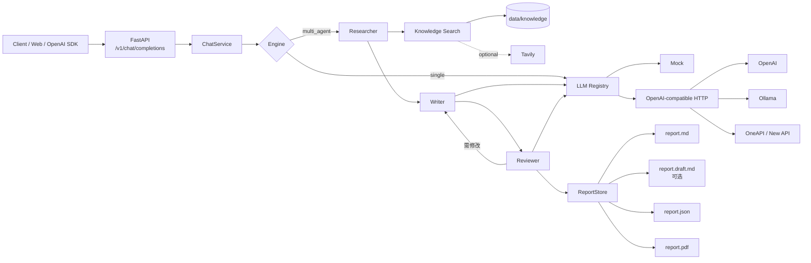

# ResearchCrew

> 一个面向学习的 **OpenAI 兼容 + 多智能体协作** 后端服务：研究员 Agent 检索资料并生成研究简报，写作 Agent 输出 Markdown 报告，支持 SSE 流式返回、报告持久化与 PDF 导出。

这个项目是「基于 CrewAI + FastAPI 的多智能体协作对话服务」的技术方向做了一个**可运行、可拆解、可继续扩展**的教学版。它不是生产系统的复刻，而是把简历里的关键词变成你能在面试中讲清楚的真实代码。

---

## 1. 它解决了什么问题

一个业务系统如果想用大模型，通常会遇到四类问题：

1. **接口不统一**：OpenAI、OneAPI、Ollama 的调用方式有差异，前端不想为每个模型写一套；
2. **复杂任务不稳定**：一次性生成长报告容易跑题、结构混乱、事实和观点混在一起；
3. **等待体验差**：研究 + 写作可能要几十秒，必须让用户看到进度和增量内容；
4. **结果留不下来**：聊天结束就没了，无法下载、追溯、二次编辑。

ResearchCrew 用一条完整链路回应这四个问题：

```
OpenAI 兼容 API
      ↓
模型适配层（Mock / OpenAI / OneAPI / Ollama）
      ↓
多智能体编排（Researcher → Writer → Reviewer）
      ↓
本地知识库检索 + 可选联网检索
      ↓
SSE 流式输出
      ↓
Markdown + JSON 元数据 + PDF 报告
```

### 和简历项目的对应关系

| 简历要点 | 本项目实现 | 主要代码 |
| --- | --- | --- |
| FastAPI 实现 `/v1/chat/completions` | 标准 Chat Completions 请求 / 响应，附 `x_agent` 扩展字段 | `app/api/routes_chat.py`、`app/schemas.py` |
| 兼容 OpenAI 调用格式 | `/v1/models`、`chat.completion`、`chat.completion.chunk`、`[DONE]` | `app/api/` |
| 多模型适配层 | 统一 `complete` / `stream` 接口；`provider/model` 路由 | `app/llm/` |
| OpenAI / OneAPI / Ollama 无缝切换 | 同一套 OpenAI-compatible HTTP 客户端，按配置切换 base_url / Key | `app/llm/openai_compat.py`、`app/llm/registry.py` |
| CrewAI 拆分研究 Agent / 报告撰写 Agent | 默认内置串行编排（研究 → 写作 → 审核，最多重写一次）；另附可选的 CrewAI 适配器 | `app/engine/multi_agent.py`、`app/engine/crewai_engine.py` |
| 普通返回 + SSE 流式输出 | 同一业务服务同时支持 `stream=false/true` | `app/service.py`、`app/api/routes_chat.py` |
| 集成文本转 PDF 工具 | Markdown → PDF，支持中文、表格、代码块、页码；自动字体子集化 | `app/tools/pdf.py` |
| 文档导出 | 每次多 Agent 请求保存 `report.md` + `report.json`，审核重写时另存 `report.draft.md`，可下载 PDF | `app/reports/store.py` |
| 自动化测试 | 18 项离线测试，覆盖接口、SSE、鉴权、路由、PDF、检索、审核重写 | `tests/` |

> 说明：默认编排器是手写的，目的是让你能逐行读懂“多 Agent 到底怎么串起来”。CrewAI 作为可选适配器提供，见第 9 节。这样既不牺牲可运行性，也保留了你简历里的技术栈。

---

## 2. 功能一览

- **OpenAI 兼容接口**：`POST /v1/chat/completions`、`GET /v1/models`
- **两种模式**：
  - `single`：一次模型调用，适合普通问答；
  - `multi_agent`：检索 → 研究简报 → Markdown 报告 → 审核（未通过则重写一次）→ 保存。
- **四种模型提供方**：
  - `mock/demo`：完全离线，零 Key，适合开发和测试；
  - `ollama/qwen2.5:7b`：本地模型；
  - `openai/gpt-4o-mini`：OpenAI 官方；
  - `oneapi/...`：OneAPI / New API 等 OpenAI 兼容代理。
- **SSE 流式输出**：标准 `data:` 增量 + 自定义 `x_phase` 阶段事件、`x_revision` 审核修改版事件；最后一条 `x_agent` 带报告元数据。
- **检索增强**：默认检索 `data/knowledge/` 下的本地 Markdown；配置 Tavily Key 后可联网。
- **报告资产**：Markdown、JSON 元数据、PDF；审核未通过时另存草稿版；支持按 report_id 查询、列表、下载。
- **PDF 导出**：纯 Python 排版，不依赖 Word / LibreOffice；自动寻找中文字体并做子集化。
- **离线 UI**：`/` 提供一个无构建步骤的演示页，能看阶段、流式草稿、审核修改版对照、来源和 PDF 下载。
- **鉴权与 CORS**：可选 Bearer API Key；跨域来源可配置。
- **Docker**：附 Dockerfile 与 docker-compose（含可选 Ollama 服务）。

---

## 3. 快速开始

### 环境要求

- Python **3.9+**（本机在 3.9.13 下通过 18 项测试；推荐 3.11 / 3.12）
- 不需要 Node.js，不需要数据库
- 默认 Mock 模式不需要任何 API Key 或 Ollama

### Windows PowerShell

```powershell
cd multi-agent-service

python -m venv .venv
.\.venv\Scripts\Activate.ps1

python -m pip install -r requirements-dev.txt

# 可选：复制配置模板；不复制也能以 mock/demo 启动
Copy-Item .env.example .env

uvicorn app.main:app --reload
```

如果 PowerShell 阻止激活脚本：

```powershell
Set-ExecutionPolicy -Scope Process Bypass
```

> 当前工作区已用 Anaconda Python 3.9 验证过依赖；如果你的 `python` 已经装好
> `fastapi / httpx / pydantic-settings / PyMuPDF`，可以跳过建 venv，直接运行
> `python -m uvicorn app.main:app --reload`。

### macOS / Linux

```bash
cd multi-agent-service
python3 -m venv .venv
source .venv/bin/activate
python -m pip install -r requirements-dev.txt
cp .env.example .env
uvicorn app.main:app --reload
```

打开：

- 演示页：<http://127.0.0.1:8000>
- Swagger：<http://127.0.0.1:8000/docs>
- 健康检查：<http://127.0.0.1:8000/healthz>

### 不启动服务，直接跑 CLI

```powershell
python scripts/demo.py "调研多智能体协作在企业知识管理中的落地方式" --mode multi_agent --pdf
```

它会直接调用 `ChatService`，逐步打印阶段、流式正文、report_id 和 PDF 路径，适合第一次阅读代码时观察完整链路。

### Docker

```powershell
docker compose up --build
```

如果要同时启动 compose 内的 Ollama：

```powershell
docker compose --profile ollama up --build
docker compose exec ollama ollama pull qwen2.5:7b
# 再把 DEFAULT_MODEL 设为 ollama/qwen2.5:7b 并重启 api
```

> 演示页不包含 API Key 输入框。开启 `API_KEY` 后，请用第 4 节的 curl / Python 示例携带
> `Authorization: Bearer <API_KEY>`，或在反向代理层统一注入。

---

## 4. 调用示例

### 4.1 Python（httpx）

```python
import httpx

payload = {
    "model": "mock/demo",
    "messages": [
        {"role": "user", "content": "调研多智能体协作在企业知识管理中的落地方式"}
    ],
    "mode": "multi_agent",
    "export_pdf": True,
}

response = httpx.post(
    "http://127.0.0.1:8000/v1/chat/completions",
    json=payload,
    timeout=180,
)
data = response.json()
print(data["choices"][0]["message"]["content"])
print(data["x_agent"]["report_id"])
print(data["x_agent"]["pdf_url"])
```

### 4.2 PowerShell

```powershell
$payload = @{
  model = "mock/demo"
  mode = "multi_agent"
  export_pdf = $true
  messages = @(
    @{ role = "user"; content = "调研多智能体协作在企业知识管理中的落地方式" }
  )
} | ConvertTo-Json -Depth 8

$bytes = [System.Text.Encoding]::UTF8.GetBytes($payload)
Invoke-RestMethod `
  -Uri "http://127.0.0.1:8000/v1/chat/completions" `
  -Method Post `
  -ContentType "application/json; charset=utf-8" `
  -Body $bytes
```

### 4.3 curl（流式）

```bash
curl -N http://127.0.0.1:8000/v1/chat/completions \
  -H "Content-Type: application/json" \
  -d '{
    "model": "mock/demo",
    "mode": "multi_agent",
    "stream": true,
    "messages": [{"role": "user", "content": "调研 RAG 的引用校验方案"}]
  }'
```

流式返回的每一帧都是标准 `chat.completion.chunk`，另外可能带：

- `x_phase`：`{stage, label, detail, agent, elapsed_ms}`；
- `x_revision`：`{index, reason, markdown}`，审核未通过时的修改版全文，`delta` 为空；
- `x_agent`：最终报告元数据，含 `report_id`、`pdf_url`、`draft_url`、`sources`、`phases`。

> `x_revision` 是刻意的旁路通道：正文流（`delta`）只承载草稿，标准 OpenAI 客户端只会读到草稿，
> 不会把草稿和修改版拼成一段。需要对照展示时，前端读 `x_revision` 渲染另一栏。

请求还可以带一个可选字段：

```json
{"report_versions": "both"}
```

`both`（默认）表示审核重写后同时保存草稿和最终版，`final` 表示只保存最终版。

### 4.4 报告接口

```text
GET /v1/reports                     报告列表
GET /v1/reports/{report_id}         报告元数据（含 has_draft / has_pdf）
GET /v1/reports/{report_id}/markdown
GET /v1/reports/{report_id}/draft   草稿版 Markdown；审核一次通过的报告没有此文件
GET /v1/reports/{report_id}/pdf     不存在时按需生成
POST /v1/tools/pdf                  直接把任意 Markdown 转成 PDF
```

如果设置了 `API_KEY`，所有 `/v1/*` 请求都需要：

```http
Authorization: Bearer <API_KEY>
```

---

## 5. 配置说明

复制 `.env.example` 为 `.env`。最常用的配置：

| 变量 | 默认值 | 说明 |
| --- | --- | --- |
| `DEFAULT_MODEL` | `mock/demo` | 请求未传 `model` 时使用 |
| `DEFAULT_PROVIDER` | `mock` | 只写模型名、不写 `provider/` 前缀时使用 |
| `API_KEY` | 空 | 留空不鉴权；线上必须设置 |
| `OPENAI_API_KEY` | 空 | OpenAI 官方 Key |
| `OPENAI_BASE_URL` | `https://api.openai.com/v1` | 可换成兼容代理 |
| `OPENAI_MODEL` | `gpt-4o-mini` | 默认 OpenAI 模型 |
| `ONEAPI_API_KEY` | 空 | OneAPI / New API Key |
| `ONEAPI_BASE_URL` | `http://localhost:3000/v1` | OneAPI 地址 |
| `OLLAMA_BASE_URL` | `http://localhost:11434/v1` | Ollama 的 OpenAI 兼容端点 |
| `OLLAMA_MODEL` | `qwen2.5:7b` | 本地模型名 |
| `TAVILY_API_KEY` | 空 | 可选联网检索 |
| `ORCHESTRATOR` | `builtin` | `builtin` 或 `crewai` |
| `DATA_DIR` | `./data` | 知识库与报告目录的父目录 |
| `REPORTS_DIR` | 空 | 为空则用 `DATA_DIR/reports` |
| `CORS_ORIGINS` | `*` | 逗号分隔的前端域名 |

### 切换到 Ollama

```powershell
ollama serve
ollama pull qwen2.5:7b
```

`.env`：

```dotenv
DEFAULT_MODEL=ollama/qwen2.5:7b
OLLAMA_BASE_URL=http://localhost:11434/v1
```

也可以只在单次请求里切换：

```json
{"model": "ollama/qwen2.5:7b", "messages": [{"role": "user", "content": "你好"}]}
```

### 切换到 OpenAI / OneAPI

```dotenv
DEFAULT_MODEL=openai/gpt-4o-mini
OPENAI_API_KEY=sk-...
OPENAI_BASE_URL=https://api.openai.com/v1
```

```dotenv
DEFAULT_MODEL=oneapi/gpt-4o-mini
ONEAPI_API_KEY=sk-...
ONEAPI_BASE_URL=http://localhost:3000/v1
```

没有配置对应 Key 时，请求会得到 `503 provider_not_configured`，而不是在代码里偷偷回退到 Mock。

---

## 6. 架构



### 请求生命周期

1. FastAPI 校验 OpenAI 格式的请求体；
2. `ChatService.prepare()` 解析 `model`，通过 `LLMRegistry` 选择 provider；如果是 `multi_agent`，选择内置或 CrewAI 引擎；
3. `MultiAgentEngine` 先检索本地 / 联网资料，调用研究 Agent 生成研究简报；
4. 写作 Agent 基于“用户任务 + 研究简报 + 资料线索”流式生成 Markdown 草稿；
5. 审核 Agent 检查草稿；未通过时按审核意见重写一次，修改版通过 `x_revision` 单独下发；
6. `ChatService` 在完成后保存报告（默认同时保留草稿版）；如果 `export_pdf=true`，同步导出 PDF；
7. 非流式请求返回完整 `chat.completion`；流式请求逐帧发送 `chat.completion.chunk`，最后发 `[DONE]`。

更细的设计说明见 [docs/ARCHITECTURE.md](docs/ARCHITECTURE.md)。

---

## 7. 目录结构

```text
multi-agent-service/
├─ app/
│  ├─ main.py                 # create_app、中间件、异常处理、路由注册
│  ├─ config.py               # 环境变量配置
│  ├─ service.py              # 业务编排 + 报告持久化
│  ├─ schemas.py              # OpenAI 兼容请求/响应模型
│  ├─ errors.py               # 统一错误 → OpenAI error 格式
│  ├─ api/
│  │  ├─ routes_chat.py       # /v1/chat/completions + SSE
│  │  ├─ routes_models.py     # /v1/models
│  │  ├─ routes_reports.py    # 报告查询 / 下载
│  │  ├─ routes_tools.py      # /v1/tools/pdf
│  │  └─ routes_health.py     # /healthz、/readyz
│  ├─ llm/
│  │  ├─ base.py              # LLM 抽象、token 估算
│  │  ├─ mock.py              # 离线 Mock 模型
│  │  ├─ openai_compat.py     # OpenAI 协议 HTTP 客户端（含 SSE 解析）
│  │  └─ registry.py          # provider/model 路由与缓存
│  ├─ engine/
│  │  ├─ base.py              # Engine 事件模型
│  │  ├─ single.py            # 单 Agent
│  │  ├─ multi_agent.py       # 研究员 → 写作 → 审核（最多重写一次）
│  │  ├─ crewai_engine.py     # 可选 CrewAI 适配器
│  │  └─ prompts.py           # 四个系统提示词
│  ├─ tools/
│  │  ├─ knowledge.py         # 中文 bigram + IDF 本地检索；可选 Tavily
│  │  └─ pdf.py               # Markdown → PDF 排版器
│  ├─ reports/store.py        # 文件型报告仓库
│  └─ static/index.html       # 无构建步骤的演示页
├─ data/knowledge/            # 示例知识库（可直接替换）
├─ data/reports/              # 运行后生成报告
├─ tests/                     # 18 项离线测试
├─ scripts/demo.py            # 不启服务直接跑
├─ docs/                      # 架构、学习路线、简历映射
├─ requirements*.txt
├─ Dockerfile
└─ docker-compose.yml
```

---

## 8. 测试与质量

```powershell
# Windows CMD：脚本会关闭第三方 pytest 插件自动加载，避免本机 langsmith 插件在离线时卡住
cmd /c scripts\test.cmd
```

PowerShell 如果被执行策略拦截，可临时绕过：

```powershell
Set-ExecutionPolicy -Scope Process Bypass
.\scripts\test.ps1
```

macOS / Linux 或干净环境：

```bash
PYTEST_DISABLE_PLUGIN_AUTOLOAD=1 python -m pytest -q
```

> 某些 Anaconda 环境自带 `langsmith` 等 pytest 插件，断网时可能在启动阶段阻塞。
> 本项目测试不需要这些插件，所以提供了 `scripts/test.ps1` / `scripts/test.cmd`。
> 如果你的环境没有这个问题，直接 `python -m pytest -q` 也可以。

覆盖范围：

- 健康检查与 `/v1/models`
- 非流式 OpenAI 响应结构
- 多 Agent 报告保存、Markdown / PDF 下载、列表
- SSE 帧结构、阶段事件、`[DONE]`、最终 `x_agent`
- 参数校验与 OpenAI 风格错误
- API Key 鉴权
- provider/model 路由与缺失 Key 报错
- OpenAI-compatible HTTP 客户端（用 `httpx.MockTransport`，不联网）
- 本地知识库检索（中文 bigram + IDF）
- PDF 中文、表格、代码块、元数据
- 报告仓库读写与非法 report_id

本机结果：

```text
13 passed
```

静态检查：

```powershell
python -m ruff check app tests scripts
```

---

## 9. 可选：启用 CrewAI

默认不安装 CrewAI，原因：

- 依赖较重，安装时间和体积明显大于核心依赖；
- 对 Python 版本较敏感；
- 默认内置编排器已经把关键链路显式写出来，更适合学习。

如果你想跑 CrewAI 版本：

```powershell
python -m pip install -r requirements-crewai.txt
```

`.env`：

```dotenv
ORCHESTRATOR=crewai
DEFAULT_MODEL=ollama/qwen2.5:7b
```

注意事项：

- CrewAI 适配器需要真实模型，不能用 `mock/demo`；
- 当前适配器用 `asyncio.to_thread` 包住 `crew.kickoff()`，是“阶段级流式”，不是 token 级流式；
- 如果安装失败，直接把 `ORCHESTRATOR` 改回 `builtin`，项目其余部分完全可用；
- 生产环境建议加最大轮次、超时、预算和工具权限控制。

---

## 10. 设计取舍与边界

- **默认 Mock**：不是假装有智能，而是让 API、SSE、报告、PDF 在没有外部服务时也能被完整测试。
- **直接写 HTTP，不依赖某家 SDK**：便于理解 OpenAI 协议、SSE 解析和错误处理；生产可以替换为官方 SDK。
- **关于 LangChain**：这个版本没有为了凑技术栈而强行引入 LangChain。LangChain 擅长组合 prompt / retriever / tool，但会把 HTTP 与 SSE 细节藏起来；本项目先把协议层写透。若你要接 LangChain，保持 `BaseLLM` 接口不变，在 `complete` / `stream` 里调用 `ChatOpenAI.ainvoke()` / `astream()` 即可，参考 `app/llm/openai_compat.py` 的错误与重试处理。
- **内置编排优先**：数据流单向、中间产物显式、容易写测试；CrewAI 作为可选替换，而不是唯一路径。
- **文件型报告仓库**：零外部服务，适合教学；生产可替换为 PostgreSQL + 对象存储。
- **PDF 用 PyMuPDF**：跨平台、无需 Office；当前表格解析是“简单 Markdown 表格”，不覆盖复杂合并单元格。
- **本地检索是轻量方案**：中文 bigram + IDF，不依赖向量库；生产应换成 BM25 / embedding + rerank。
- **未包含**：用户体系、配额计费、限流、任务队列、多租户隔离、完整可观测性。这些是下一步扩展点，不要在面试里说成“已上线”。

PyMuPDF 使用 AGPL-3.0 许可证；如果项目要商用，请先确认许可证或替换为 ReportLab / 其他方案。

---

## 11. 继续扩展

`Reviewer` Agent 已内置（见第 6 节）。下面按难度递增：

1. 增加真正的引用编号：检索结果带 `[1]`，正文引用并在末尾列来源；
2. 增加 token 级心跳：研究阶段每 15 秒发一次 SSE 注释，避免代理超时；
3. 增加限流与幂等键：按 API Key / IP 限流，`Idempotency-Key` 防重复生成；
4. 换成向量检索：sentence-transformers / BGE + FAISS，比较召回效果；
5. 增加评测集：固定 20 个问题，比较不同模型的结构完整率、引用覆盖率和延迟；
6. 增加 OpenTelemetry：记录首 token 延迟、阶段耗时、失败率；
7. 接入对象存储和 PostgreSQL：把 `ReportStore` 换成生产实现。

学习路线和面试讲法见：

- [docs/LEARNING_GUIDE.md](docs/LEARNING_GUIDE.md)
- [docs/ARCHITECTURE.md](docs/ARCHITECTURE.md)
- [docs/RESUME_MAPPING.md](docs/RESUME_MAPPING.md)

---

## License

MIT。示例知识库内容仅用于教学演示。
